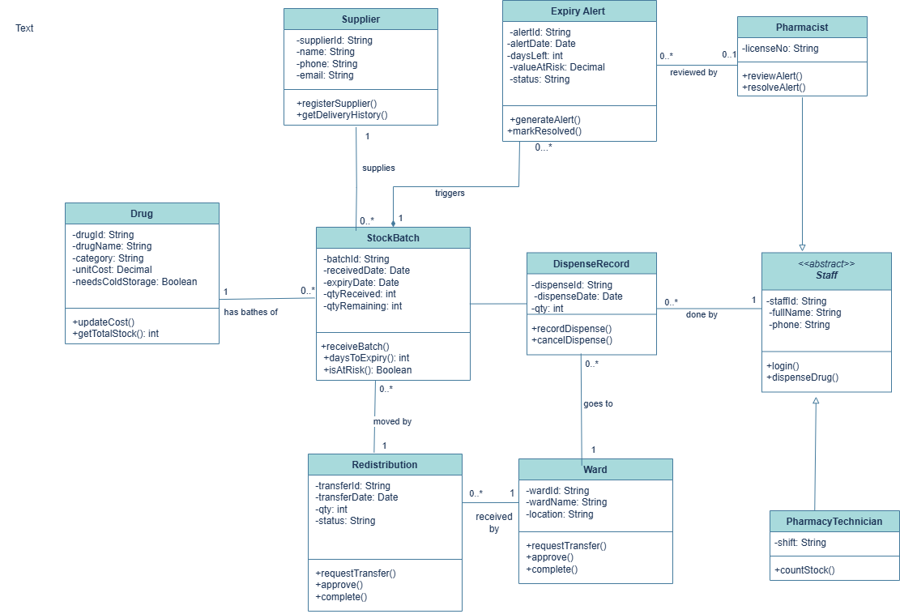

# PharmaGuard: Hospital Pharmacy Stock and Expiry System

UML Class Diagram Modelling Assignment | Kigali Independent University (ULK)
Instructor: Eric Maniraguha

**Group members:** Henriette Desanges Uwayo (202511464) and Uwase Nadia (202512339)

**GitHub:** Des23-ops

## Business idea
A hospital pharmacy buys medicines in batches, and every batch has its own expiry date. PharmaGuard keeps the
suppliers, batches, usage by wards and staff in one place, and warns the pharmacy early when a batch is likely to be
left over, so it can be moved to a ward that needs it.

## Problem
Medicines are thrown away because they expire unused. This wastes money and cold-storage space, and sometimes another
ward is short of the same medicine. Nobody sees the risk in time because stock, usage and expiry are not linked.

## Scope
**Covered:** drugs, suppliers, stock batches with expiry dates, dispensing to wards, expiry alerts, redistribution
of near-expiry stock, and pharmacy staff.
**Not covered:** patient records, prescriptions, billing, accounting, other hospital departments, and building the
real software (this project is design only).

## Main classes
| Class | Responsibility |
|---|---|
| Drug | Keeps the details of each medicine: name, category, cost and whether it needs cold storage. |
| Supplier | Keeps the companies that deliver medicines and how to contact them. |
| StockBatch | One delivery of a drug. It has its own expiry date and shows how much is left and whether it is at risk. |
| DispenseRecord | Records every time medicine leaves a batch and goes to a ward. |
| Ward | A hospital unit that asks for and receives medicines. Its usage shows how much it needs. |
| Staff (abstract) | Holds what all pharmacy workers share: ID, name, phone, login and dispensing. |
| Pharmacist | A staff member who reviews and closes expiry alerts. |
| PharmacyTechnician | A staff member who counts and checks the stock on the shelves. |
| ExpiryAlert | A warning for a batch that is close to expiry with a lot still unused. It shows the money at risk. |
| Redistribution | Moves near-expiry stock from the pharmacy to a ward that can use it. |

## Relationships
| Classes | Type | Multiplicity |
|---|---|---|
| Drug - StockBatch | Association | 1 to 0..* |
| Supplier - StockBatch | Association | 1 to 0..* |
| StockBatch - DispenseRecord | Association | 1 to 0..* |
| Ward - DispenseRecord | Association | 1 to 0..* |
| Staff - DispenseRecord | Association | 1 to 0..* |
| StockBatch - ExpiryAlert | Composition | 1 to 0..* |
| Pharmacist - ExpiryAlert | Association | 0..1 to 0..* |
| StockBatch - Redistribution | Association | 1 to 0..* |
| Ward - Redistribution | Association | 1 to 0..* |
| Pharmacist, PharmacyTechnician and Staff | Generalization | none |

## UML class diagram


## Repository contents
```
uml-class-diagram-assignment/
├── README.md
├── documentation/
│   ├── report_1_project_description.pdf
│   └── report_2_uml_class_diagram.pdf
└── diagrams/
    ├── uml_class_diagram.drawio
    └── uml_class_diagram.png
```

**File descriptions**
- **README.md:** introduces the project, explains the business idea and scope, and gives an overview of the classes and relationships.
- **report_1_project_description.pdf:** the project description, problem statement, scope and main requirements.
- **report_2_uml_class_diagram.pdf:** the UML class diagram with its classes, attributes, methods, multiplicities and an explanation.
- **uml_class_diagram.drawio:** the editable diagram, made in draw.io.
- **uml_class_diagram.png:** an exported image of the completed electronic diagram.
